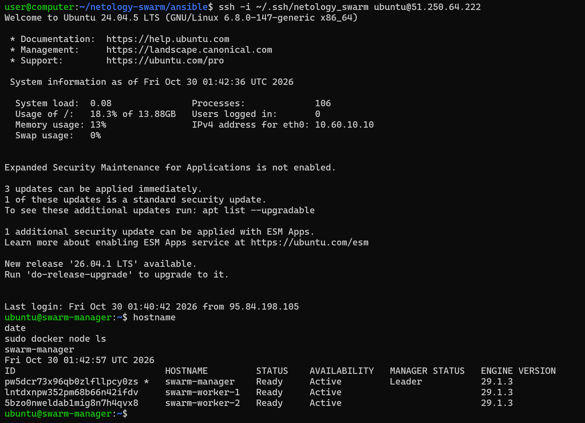

# Docker Swarm | Борис Горелик

С помощью Terraform в Yandex Cloud создана сеть с тремя подсетями и тремя виртуальными машинами Ubuntu: swarm-manager, swarm-worker-1 и swarm-worker-2. Из-за зональных ограничений дисковой квоты узлы размещены в зонах ru-central1-a, ru-central1-d и ru-central1-e, но находятся в одной облачной сети.

С помощью Ansible на всех ВМ установлен Docker Engine 29.1.3. На swarm-manager инициализирован Docker Swarm, два остальных узла присоединены к кластеру как workers. Для взаимодействия узлов используются внутренние IP-адреса.

Команда docker node ls показывает три узла в состоянии Ready с доступностью Active. Узел swarm-manager имеет статус Leader. Playbook завершился без ошибок: failed=0, unreachable=0 на всех узлах.
